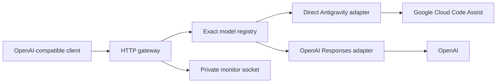

# ai-router

A Rust gateway for OpenAI-compatible Chat Completions and Responses clients.
It routes exact model IDs to a direct Antigravity adapter or, when enabled,
the independent OpenAI Responses provider. The gateway runs model requests
only; it does not run client tools, native agents, uploads, or artifacts.

The former AGY CLI implementation is preserved on the published
`archive/agy-cli-2026-10-20` branch. Its `ai-router-auth` volume remains
unmounted for rollback. The direct adapter uses its own
`ai-router-antigravity-auth` volume.



Both providers have separate account state, readiness, admission limits, and
failure handling. A provider outage does not reroute a request to another
provider. Client tools are returned to the client after schema validation; the
client executes them and sends results in later history. Forced or named tool
selection is unsupported. Media input and native execution are not supported.

## Local Docker quick start

Docker is required. Use exported process environment values and pass
`--env-file /dev/null` on every Compose command so Compose does not load a local
dotenv file.

```sh
docker build --target gateway -t ai-router:local .
./scripts/keygen.sh n8n model
```

Save the generated raw client key in your client and export only its digest
record in the shell used to start Compose:

```sh
export AI_ROUTER_KEYS='[{"id":"n8n","sha256":"REPLACE_WITH_GENERATED_DIGEST","scopes":["model"]}]'
./scripts/login.sh agy
docker compose --env-file /dev/null up -d
curl --fail http://127.0.0.1:8090/health
curl --fail http://127.0.0.1:8090/ready
```

The unified helper starts a one-off container with the selected provider's dedicated auth
volume. It performs a fresh router-owned Google sign-in using the reviewed,
pinned OMP OAuth registration. It does not import the prior AGY CLI profile.
The callback defaults to port 1456 and is published on host loopback; select an
alternate port with `--port N`. For a remote Docker host, forward that port
over SSH and keep the tunnel open while login runs:

```sh
ssh -L 1456:127.0.0.1:1456 USER@SERVER
./scripts/login.sh agy login --port 1456
```

The gateway must be stopped before login, logout, resume, or account selection
changes provider state. The helper checks this condition. Use
`./scripts/login.sh openai` for OpenAI sign-in, then set
`AI_ROUTER_OPENAI_ENABLED=true` in the process environment before starting
Compose to enable that provider. `scripts/antigravity.sh` and
`scripts/openai.sh` remain compatibility wrappers around the unified helper.

## API

All `/v1` endpoints require `Authorization: Bearer <client-key>`.

| Route | Purpose |
| --- | --- |
| `GET /health` | Public process liveness |
| `GET /ready` | Ready when an enabled provider has a routable model |
| `GET /v1/models` | Exact IDs from currently ready provider catalogues |
| `GET /v1/capabilities` | Provider status, supported features, and limits |
| `POST /v1/chat/completions` | Chat text, streaming, tools, and validated JSON |
| `POST /v1/responses` | Responses items, streaming events, tools, and validated JSON |

The removed `/v1/agy/runs` route and all child routes return 404. Client keys
accept only the `model` scope.

Responses output items are kept in client-scoped memory by default and can be
replayed with `item_reference`. Items expire after 24 hours; per-client and
global bounds are reported by `/v1/capabilities`. Restart clears the store.
Encrypted reasoning replay is additionally scoped to the provider and account
generation. `store:false` disables storage of new response items.

Positive Chat `max_tokens` / `max_completion_tokens` and Responses
`max_output_tokens` are best-effort visible-answer guidance, not hard limits.
The router preserves actual usage and keeps the legacy `agy_usage_partial`
field alongside `ai_router_usage_partial` until a separately versioned API
change. Neither provider is promised to enforce an output-token cap.

## Operations and design notes

[The latest upstream review](docs/upstream-review-2026-10-21.md) records the Hub 2.24.0 baseline and explicit session-preserving upgrade.
[Local operations](docs/operations.md) covers login, volumes, OpenAI opt-in,
and monitoring. [Capabilities](docs/capabilities.md) describes the current
model-only surface and validation limits. [Interfaces](docs/interfaces.md)
documents the Rust provider seams.

Local Docker validation completed separate Google sign-in and discovery of
13 reviewed Antigravity IDs alongside 7 OpenAI IDs. Flash High, Opus Medium and
Sonnet High passed both APIs, streaming, JSON and client-tool round trips.
Argon Medium returned upstream quota errors. See [validation](docs/validation.md)
for exact evidence and remaining matched-latency and real-refresh gates.

The Docker image is nonroot with a read-only root filesystem. It has no AGY CLI,
native sandbox, MCP relay, host home mount, or Docker socket. The monitor uses a
private Unix socket and persists bounded request metadata separately from
bounded request/response detail retained only in memory.
