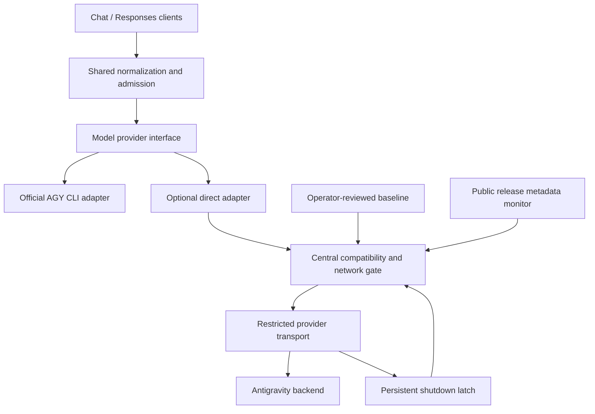

# Alternative implementation: direct Antigravity provider with compatibility guards

Status: direct model-only implementation present on 2026-10-20; local validation
and live acceptance in progress. No supported renewable-token handoff was found
in public interfaces; operator selected a separate OMP-registration sign-in.
Research refreshed: 2026-10-20. Historical research below dates to 2026-10-04.

## Current decision and refreshed evidence

The operator selected a complete replacement of AGY subprocess inference on
`main`, including removal of native-agent endpoints. The current implementation
is preserved locally as `archive/agy-cli-2026-10-20`, pointing to
`4d23e015ba273ed1600ec43c7815f791b4c04286`. This branch has not been pushed.
OpenAI remains a separate provider. Direct-provider work is described in the [plan](direct-antigravity-plan.md) and
[DAG](direct-antigravity-dag.md).

The operator also selected a pinned reviewed protocol: new releases generate
alerts, while actual protocol/authentication failures stop affected traffic.
This supersedes the historical proposal's automatic shutdown on every public
release or unavailable release manifest. A public manifest must never silently
change the advertised client identity.

The local OMP executable was identified without running it or accessing its
configuration/authentication state. Its package version could not be established
reliably through static metadata. The findings below concern verified upstream
source, not a claim about that installed executable.

### Inspected upstream

- Pinned implementation reference: [`2220e58146ebe31508e7a216242840d373e082d0`](https://github.com/can1357/oh-my-pi/commit/2220e58146ebe31508e7a216242840d373e082d0),
  committed 2026-10-19 23:50:20 +02:00; coding-agent package version 18.12.3.
- Latest reviewed public HEAD on 2026-10-20:
  [`4bca62d432b28e11f1479c7fd217546a182ab6db`](https://github.com/can1357/oh-my-pi/commit/4bca62d432b28e11f1479c7fd217546a182ab6db).
  Compared all ten baseline-related inference, conversion, identity, discovery,
  OAuth and model-compatibility paths against the pinned reference. Nine were
  byte-identical. The only changed path, `classes/anthropic.kdl`, narrows server
  compaction to the `anthropic-messages` API on other provider routes; it does
  not change Antigravity's CCA request or replay contract.
- Release-tag revision:
  [`53a0377db6845e0dae606146130766ec92d407fd`](https://github.com/can1357/oh-my-pi/commit/53a0377db6845e0dae606146130766ec92d407fd).
- Compared against the earlier document's `6d8552d` and v18.1.10 references.
  Source comparison used public source without saved-authentication access.
  Subsequent operator-authorized local Docker evaluation is distinguished below.

The newer release/revision observations produce advisory alerts. This comparison
did not change the pinned protocol, endpoint or `2.19.1` identity automatically.

### Local wire finding: empty visible replay parts

Local Docker evaluation on 2026-10-20 exposed a real Claude tool-continuation
failure that the synthetic upstream initially missed. Opus 5.5 returned a valid
client tool call, but replaying its result produced HTTP 400. The nested
Anthropic validation message reported
`messages.<index>.content.0.text.text: Field required`.

The adapter retained a standalone empty visible text/signature part in private
replay and sent it back alongside the function call. Omitting these empty visible
parts from the wire resolved an actual Opus 5.5 Chat tool handoff and result
round trip. The missing-field path is consistent with CCA omitting a zero-valued
protobuf text field while still constructing an Anthropic text block; that
backend translation mechanism is an inference, rather than inspected service
implementation.

The fix keeps private replay metadata in bounded memory, preserves typed empty
`thought:true` parts with signatures, and preserves all nonempty visible text,
including whitespace. Function-call replay is also canonicalized to its
`functionCall` payload plus an optional nonempty signature, avoiding a second
empty text payload. Reviewed Claude tiers request private thought/signature
state through `includeThoughts:true`, without guessed thinking budgets or output
caps. Session IDs follow the source's stable negative-decimal pattern, scoped to
the router owner, exact model and account generation.

Stable session IDs and private-state requests were retained as source-aligned
behavior; they did not independently resolve this rejection. A controlled test
omitting Claude function-part IDs also failed, so that candidate was reverted:
Claude keeps IDs, while Gemini uses ordered groups without wire IDs. This
distinguishes the successful empty-visible-part fix from unproven explanations.
Subsequent coordinator-run local live suites passed 15 checks for each of
`claude-opus-5-5-medium`, `claude-sonnet-5-5-high`,
and `gemini-3.8-flash-high`. Flash Low passed the same 15 checks earlier in
development and was not rerun after the final replay fix. These cover streaming and
nonstreaming Chat/Responses text, both JSON-schema interfaces, both tool handoffs
and complete result round trips, and client disconnects. These correctness
checks do not substitute for a matched latency comparison.

### What explains the potential speed benefit

OMP sends typed conversation data directly to Cloud Code Assist's streaming
endpoint. It avoids AGY subprocess creation, isolated custom-agent discovery,
prompt-encoded conversation replay and the inert MCP relay used by this router.
See the [inference adapter](https://github.com/can1357/oh-my-pi/blob/2220e58146ebe31508e7a216242840d373e082d0/packages/ai/src/providers/google-gemini-cli.ts).
This supports a mechanism for lower overhead; it does not establish a speedup
for matched model, effort, context, tools and output. Reasoning and upstream
queue time remain outside the transport's control.

### Changes that matter since the original research

| Change | Consequence for this router |
| --- | --- |
| [Rejected discovery distinguished from transient failure](https://github.com/can1357/oh-my-pi/commit/cc0ee3d761) | Do not recover an explicitly rejected account through another endpoint. |
| [Disabled model rows removed](https://github.com/can1357/oh-my-pi/commit/158ec02202) | Validate the authenticated roster before advertising IDs; backend-listed does not necessarily mean usable. |
| [Tool results restored to call order](https://github.com/can1357/oh-my-pi/commit/a5ff299b20), [including associated images](https://github.com/can1357/oh-my-pi/commit/a8c6867be9) | Preserve caller IDs and reorder results only according to the original call group where the wire protocol requires it. |
| [Reasoning replay and text signatures](https://github.com/can1357/oh-my-pi/commit/8d0e4bb9ee), [empty-thought signatures](https://github.com/can1357/oh-my-pi/commit/343b480362), [signature-only thoughts](https://github.com/can1357/oh-my-pi/commit/ab7a952d7a) | Test opaque state across text/tool turns, including empty thought parts. |
| [Claude image constraints](https://github.com/can1357/oh-my-pi/commit/58153d0cad) | Media needs separate bounds and contracts; text support does not establish image support. |

The request identity/version helper is unchanged since `6d8552d`. It still
discovers a public version dynamically, allows environment overrides, and falls
back to a predefined identity. Pinning OMP alone does not pin that behaviour.
[Source](https://github.com/can1357/oh-my-pi/blob/2220e58146ebe31508e7a216242840d373e082d0/packages/catalog/src/wire/gemini-headers.ts).

### Policies and edge cases to address before porting

These are source findings, not live reproductions or a claim that every OMP
policy is a defect in its agent-oriented use case.

| Finding | Required treatment |
| --- | --- |
| Fixed wire profiles overwrite the requested output-token limit. | Preserve truthful budget capabilities. Do not advertise a hard cap without independent enforcement/evidence. |
| Gemini tool mode `ANY`/`NONE` has backend limitations; OMP uses a tool-only prompt workaround. | Keep unsupported forced/named tool modes rejected initially. Remove inventory for `none`, validate returned calls, and fail on violations. |
| Flash leak handling can remove a legitimate leading JSON object with a string `thought` member; thinking-fence healing also rewrites content. | Preserve visible text verbatim. Do not inherit agent-specific content heuristics. |
| The custom CCA signature-only branch signs the current block without checking `thought:true`, or drops the signature when no block exists; shared handling was fixed separately. | Write dedicated synthetic fixtures for empty signed thoughts after text and before tools; preserve typed block identity. |
| Empty-stream retry uses a fetch without the initial response-header watchdog. | Apply the original absolute deadline to every attempt and every phase. Default generation dispatch to one attempt. |
| Discovery accepts an object with no recognized roster fields as a successful empty result. | Distinguish a valid empty catalogue from malformed data before publishing a new snapshot. |

Inference findings above come from the
[custom adapter](https://github.com/can1357/oh-my-pi/blob/2220e58146ebe31508e7a216242840d373e082d0/packages/ai/src/providers/google-gemini-cli.ts),
[shared conversion code](https://github.com/can1357/oh-my-pi/blob/2220e58146ebe31508e7a216242840d373e082d0/packages/ai/src/providers/google-shared.ts),
and [discovery](https://github.com/can1357/oh-my-pi/blob/2220e58146ebe31508e7a216242840d373e082d0/packages/catalog/src/discovery/antigravity.ts).

Quota prefers a summary endpoint and can fall back to a legacy probe, including
after rejection. Inference/discovery can also fail over across production and
sandbox endpoints. A router account restriction must stop those additional
attempts, not just reject the current chat call.
[Quota source](https://github.com/can1357/oh-my-pi/blob/2220e58146ebe31508e7a216242840d373e082d0/packages/ai/src/usage/google-antigravity.ts).
Image generation is a separate transport/parser path and must remain excluded
until it passes the same checks.
[Image source](https://github.com/can1357/oh-my-pi/blob/2220e58146ebe31508e7a216242840d373e082d0/packages/ai/src/images/google-antigravity.ts).

### Model IDs and authentication

The [wire variant table](https://github.com/can1357/oh-my-pi/blob/2220e58146ebe31508e7a216242840d373e082d0/packages/catalog/src/compat/rules/taxonomy/_collapse.kdl)
contains the current 13 public IDs: the three Argon tiers, three Flash 3.8
tiers, three Opus 5.5 tiers, three Sonnet 5.5 tiers, and
`gpt-oss-120b-medium`. Preserve exact usable wire IDs; do not import OMP's
collapse into five logical selection IDs. The actual account roster still gates
advertising and dispatch. Numeric reasoning budgets are not established by an
ID suffix alone; conflicting caller effort must not silently select another ID.

OMP uses independent Google consent through a bundled OAuth registration, not
an import of CLI credentials. It also obtains project metadata and can perform
remote free-tier onboarding. These operations need explicit design and the same
restricted transport as inference. A bundled OAuth client secret is not proof
that the registration is appropriate for a separate application, and the
generic flow engine supports optional PKCE, but the inspected Antigravity rule
does not enable it.
[OAuth configuration](https://github.com/can1357/oh-my-pi/blob/2220e58146ebe31508e7a216242840d373e082d0/packages/catalog/src/compat/rules/auth/google-antigravity.kdl),
[flow engine](https://github.com/can1357/oh-my-pi/blob/2220e58146ebe31508e7a216242840d373e082d0/packages/ai/src/registry/engine/oauth-code.ts),
[project provisioning](https://github.com/can1357/oh-my-pi/blob/2220e58146ebe31508e7a216242840d373e082d0/packages/ai/src/registry/oauth/google-antigravity.ts).

Google documents shared sign-in across its official App, CLI, IDEs and SDK.
This does not document an export or renewable token-provider interface for an
independent Rust backend client.
[Official authentication guide](https://www.antigravity.google/docs/install/).
The reuse-first public-interface investigation found no documented renewable
handoff suitable for the direct adapter. No saved tokens, keychain, protected
files or OMP configuration were inspected. The operator selected independent
Google consent using the reviewed OMP registration, and local Docker sign-in
and project discovery succeeded. This is fresh authorization, rather than
credential import. The legacy AGY auth volume remains preserved for rollback;
no live-server migration was performed.
If evidence requires secret-file contents, the operator performs that step
outside Codex. Do not make raw-file extraction a prerequisite disguised as an
implementation detail.

Selective translation of substantial OMP code requires retaining the applicable
MIT notice. This project additionally requires source commit/path provenance
when code is incorporated.
[License](https://github.com/can1357/oh-my-pi/blob/2220e58146ebe31508e7a216242840d373e082d0/LICENSE).
Google's terms were rechecked on 2026-10-20: section 6 still restricts third-party
Antigravity access; the opening paragraph has specified enterprise exceptions.
Protocol compatibility does not establish permission or account safety.
[Current terms](https://antigravity.google/terms).

## Historical proposal (2026-10-04)

The remaining sections preserve the original reasoning and stricter guard
proposal. Where they differ, the current decisions and linked replacement plan
take precedence. In particular, direct mode will replace the CLI on `main`,
native execution is being removed, and public-release alerts alone will not
disable a pinned implementation.

This records a possible alternative to the official `agy` subprocess adapter.
It does not replace the decisions in [PLAN.md](../PLAN.md). The current router
continues to use the official CLI, with authentication retained inside it.

## Idea and potential benefits

Implement a model provider in Rust that talks directly to the Antigravity
backend, following the architectural separation used by oh-my-pi (OMP): typed
conversation context, model-specific capabilities, a common streaming event
interface, and separate provider authentication, transport, and quota logic.

Direct access could remove several limitations of the CLI adapter:

- Send system, user, assistant, tool-call, and tool-result messages as native
  protocol structures instead of replaying a conversation inside a prompt.
- Receive tool calls directly instead of capturing them through an inert MCP
  relay; support multiple calls where the selected model/backend permits them.
- Control incremental output, reasoning options, usage mapping, and transport
  error handling at the provider layer.
- Avoid CLI startup and custom-agent verification overhead.
- Associate model capabilities and quota health with the actual model family.

These are potential benefits, not verified capabilities. Direct transport does
not establish reliable forced tool selection, constrained JSON decoding, hard
output-token limits, or access to every model or media endpoint. OMP contains
provider-specific workarounds, including fixed output limits for some models.
Native execution, sandboxing, files, and artifacts remain separate concerns;
the existing native CLI profile would retain its verification gate.

## Research findings

OMP's `google-antigravity` provider calls Cloud Code Assist directly using OAuth;
it does not launch `agy` for those model requests. Its identity headers and
request constants are based on captured Antigravity **Hub** requests, which
must not be assumed to be identical to the **CLI** protocol.

OMP can discover a newer Antigravity version from a public update manifest and
advertise that version without an OMP upgrade. The inspected v18.1.10 source
and current upstream both contain this behaviour. If discovery fails, the
implementation retains a predefined fallback version. Pinning the OMP package
alone therefore does not freeze the effective request identity.

Backend access is distributed across inference, model discovery, quota, and
image-generation paths. Some paths can use alternate endpoints. A guard around
the chat handler alone would not stop all direct calls.

The word "signature" needs a precise meaning here:

| Meaning | Relevance |
| --- | --- |
| Client identity and request format | Headers, endpoint selection, schemas, model routing, and session metadata can be compared against an approved baseline. |
| Release checksum or code hash | Detects changes to a local artifact; does not prove backend compatibility or permission to use it. |
| Model thought signature | Opaque reasoning state preserved across turns; does not certify that the caller is an official client. |

No documented mechanism was found that certifies a third-party request as
permitted merely because its observable identity matches an official client.

## Account risk and design boundary

Google's current Antigravity terms, section 6, explicitly restrict third-party
access, including Antigravity OAuth, and describe possible suspension or
termination of Antigravity and/or Gemini CLI accounts. Matching request headers
does not remove that restriction.

The proposed guards address accidental protocol drift. They cannot promise
protection against account suspension: backend behaviour or enforcement may
change without a client release, and a failure response arrives only after a
request has reached Google. Already-sent requests cannot be recalled.

The official CLI boundary is the preferred engineering approach when account
protection is the priority, because the official client owns authentication
and request formatting. This is an engineering assessment, not evidence of a
measurable difference in suspension risk or a guarantee that the existing
gateway complies with the terms. Provider authorization or a documented API
integration addresses permission to access the service. Documented API access
may have separate billing, authentication, and model availability; it must not
be presented as an equivalent way to consume the personal subscription.

## Proposed architecture

Keep the existing public API, authentication, limits, telemetry policy, client
tool ownership, and cancellation semantics. Use the existing `RunEvent` and
`RunResult` concepts as the shared output contract. Preserve typed history
internally so serialization is an adapter responsibility.

Direct mode would be disabled by default and selected explicitly. Authentication
would require a separately reviewed design; this proposal does not authorize
extracting or copying the CLI's cached credentials. The network gate must cover
every relevant authenticated backend request, including background activity
and provider-specific authentication/control-plane requests.

## Possible guards

### 1. Exact approved baseline

Record the adapter revision, relevant dependency/artifact hashes, reference
client surface and platform, public release metadata, allowed endpoints,
identity headers, request schemas, model/effort routing, and response contracts.
Validate the baseline itself and prevent unreviewed runtime overrides.

Hub and CLI references must be distinguished. Agreement with OMP's serializer
proves agreement with that serializer, not independent agreement with AGY.
Any official reference must have an independently established provenance.

### 2. Public release monitoring with bounded freshness

Observe relevant official release manifests and OMP adapter changes without
using account credentials. A newly observed release or relevant adapter change
disables direct access pending review, even if the pinned older version might
still function. This conservative rule intentionally allows false positives.

Monitoring results have a bounded, operator-configured validity period.
Missing, malformed, or stale evidence blocks dispatch. Discovering a new
version must never automatically update the advertised identity or authorize
the new protocol. A predefined version fallback cannot satisfy this gate.

This detects changes only when observed; polling cannot guarantee a stop at
the exact instant a remote change occurs.

### 3. Offline request and response contract checks

Build representative requests using synthetic messages, tools, and dummy auth.
Compare canonical structures with approved fixtures before network dispatch.
Cover text, history replay, each supported effort, tool results, schema output,
usage, discovery, quota, and any separately enabled media path.

Exclude credentials, prompt contents, timestamps, random IDs, and other
per-request values from persistent fingerprints. Validate dynamic fields by
type and format rather than expecting byte-for-byte equality. Unknown contract
changes fail closed; snapshots must not update themselves to make tests pass.

Offline success is compatibility evidence for those fixtures. A successful
live canary is not evidence that the access method is authorized or account-safe.

### 4. Central gate immediately before network dispatch

Require an enabled provider, matching approved artifact/contract, fresh
monitoring evidence, an allowed endpoint, and a clear shutdown latch before
every relevant request. The decision must apply to retries and background
calls as well as the initial inference request.

All direct paths must use the restricted transport. Enforce endpoint
restrictions at the network boundary as well as in application code so an
unguarded dependency cannot silently bypass the gate. On closure, reject
queued direct work and prevent new dispatches; cancel in-flight work where
possible without claiming that already-transmitted work was prevented.

### 5. Persistent shutdown latch and controlled recovery

An unexpected protocol response, authentication/permission failure, or explicit
account restriction opens the latch. Ordinary quota exhaustion has separate,
model-family-aware cooldown handling and must not automatically be interpreted
as a changed client identity.

Persist the latch across restarts. Do not automatically switch endpoints,
rotate accounts, copy newer identity fields, or re-enable direct access.
Re-enabling requires investigation and an operator-reviewed baseline. Explicit
account restriction signals stop all access through that account, including
any CLI fallback, pending operator recovery.

### 6. Explicit failure and routing behaviour

Return a clear unavailable error when direct compatibility cannot be established,
and expose the reason through the private monitor. Log only bounded metadata,
such as the baseline revision and failure category, never credentials or
conversation payloads.

Do not silently rerun a failed direct request through the CLI, especially after
streaming starts or an account restriction is observed. CLI mode remains a
separately selected route with its own readiness and verification requirements.

## Possible implementation sequence

1. Introduce the model provider interface around the existing CLI adapter,
   preserving behaviour and leaving native execution separate.
2. Implement a direct request serializer and response decoder against synthetic
   fixtures, with network dispatch disabled.
3. Define the approved baseline format, artifact checks, monitoring freshness,
   persistent latch, and central restricted transport.
4. Test unknown revisions, changed headers/schemas/endpoints, manifest failure,
   stale evidence, background calls, retries, restart persistence, concurrent
   requests, and cancellation while the gate closes. Require zero new backend
   dispatches after closure; account separately for requests already sent.
5. Review authentication, service permissions, and model-specific capabilities
   before considering any operator-enabled live evaluation. Secret-dependent
   steps must be performed by the user outside Codex.
6. Retain the official CLI implementation unless the alternative's benefits,
   remaining compatibility limits, and account-risk implications are acceptable.

No deployment, direct-backend authentication, credential access, or live
inference testing is authorized by this document.

## Existing foundations and sources

The archived CLI implementation pins official AGY downloads and checks their SHA-512
digests in `scripts/install-agy.sh` on `archive/agy-cli-2026-10-20`, verifies the CLI
version and initial public tool inventory in `src/runner.rs` on that archived branch,
and checks provider readiness before admitting generation. These provide a
starting point for stronger compatibility checks on either implementation.

Research references, checked on 2026-10-04:

- [Google Antigravity terms, especially section 6](https://antigravity.google/terms).
- [Google Antigravity FAQ on third-party access](https://www.antigravity.google/docs/faq/#why-cant-i-use-third-party-software-such-as-claude-code-openclaw-or-opencode-with-my-antigravity-login).
- [Official installation and authentication documentation](https://www.antigravity.google/docs/cli/install/).
- [Official installer source](https://antigravity.google/cli/install.sh), inspected without execution.
- [Official changelog](https://www.antigravity.google/docs/changelog).
- [Official SDK overview and documented API authentication](https://www.antigravity.google/docs/sdk/overview/).
- [Google's explanation of model thought signatures](https://ai.google.dev/gemini-api/docs/thinking).
- [OMP v18.1.10 identity/version discovery](https://github.com/can1357/oh-my-pi/blob/f241301c83726afe75a847e919b89977a54dafbe/packages/catalog/src/wire/gemini-headers.ts).
- [OMP researched upstream identity/version discovery](https://github.com/can1357/oh-my-pi/blob/6d8552d7f9df1852826923f07f0eed4fe29511f3/packages/catalog/src/wire/gemini-headers.ts).
- [OMP direct inference adapter](https://github.com/can1357/oh-my-pi/blob/6d8552d7f9df1852826923f07f0eed4fe29511f3/packages/ai/src/providers/google-gemini-cli.ts).
- [OMP model discovery](https://github.com/can1357/oh-my-pi/blob/6d8552d7f9df1852826923f07f0eed4fe29511f3/packages/catalog/src/discovery/antigravity.ts).
- [OMP quota handling](https://github.com/can1357/oh-my-pi/blob/6d8552d7f9df1852826923f07f0eed4fe29511f3/packages/ai/src/usage/google-antigravity.ts).
- [OMP image-generation transport](https://github.com/can1357/oh-my-pi/blob/6d8552d7f9df1852826923f07f0eed4fe29511f3/packages/ai/src/images/google-antigravity.ts).
