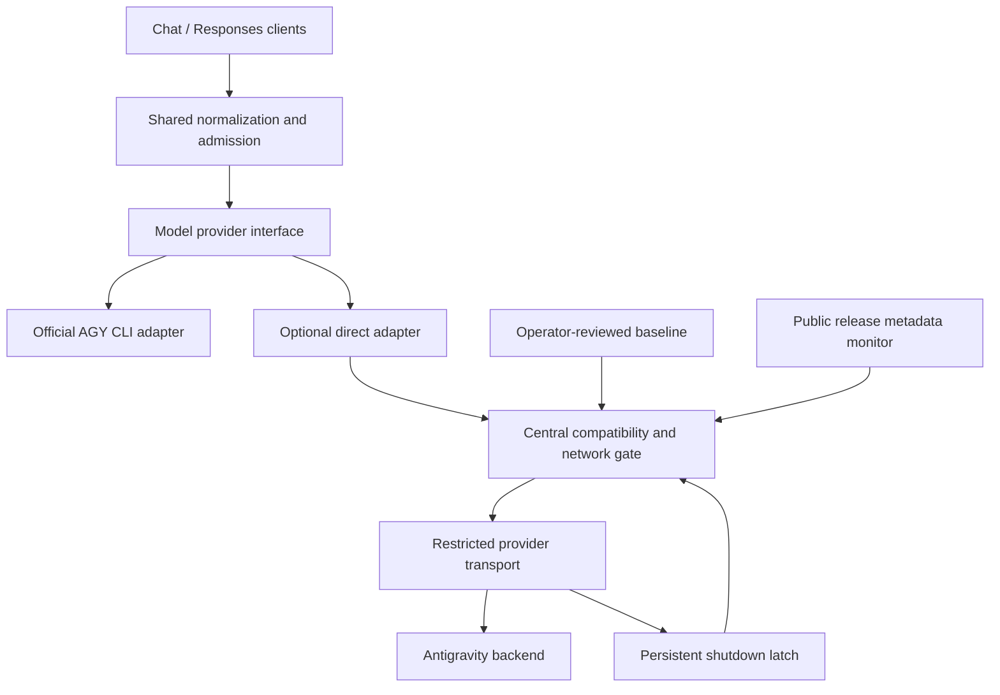

# Alternative implementation: direct Antigravity provider with compatibility guards

Status: exploratory proposal; not implemented or selected for production.
Research date: 2026-10-04.

This records a possible alternative to the official `agy` subprocess adapter.
It does not replace the decisions in [PLAN.md](../PLAN.md). The current router
continues to use the official CLI, with authentication retained inside it.

## Idea and potential benefits

Implement a model provider in Rust that talks directly to the Antigravity
backend, following the architectural separation used by oh-my-pi (OMP): typed
conversation context, model-specific capabilities, a common streaming event
interface, and separate provider authentication, transport, and quota logic.

Direct access could remove several limitations of the CLI adapter:

- Send system, user, assistant, tool-call, and tool-result messages as native
  protocol structures instead of replaying a conversation inside a prompt.
- Receive tool calls directly instead of capturing them through an inert MCP
  relay; support multiple calls where the selected model/backend permits them.
- Control incremental output, reasoning options, usage mapping, and transport
  error handling at the provider layer.
- Avoid CLI startup and custom-agent verification overhead.
- Associate model capabilities and quota health with the actual model family.

These are potential benefits, not verified capabilities. Direct transport does
not establish reliable forced tool selection, constrained JSON decoding, hard
output-token limits, or access to every model or media endpoint. OMP contains
provider-specific workarounds, including fixed output limits for some models.
Native execution, sandboxing, files, and artifacts remain separate concerns;
the existing native CLI profile would retain its verification gate.

## Research findings

OMP's `google-antigravity` provider calls Cloud Code Assist directly using OAuth;
it does not launch `agy` for those model requests. Its identity headers and
request constants are based on captured Antigravity **Hub** requests, which
must not be assumed to be identical to the **CLI** protocol.

OMP can discover a newer Antigravity version from a public update manifest and
advertise that version without an OMP upgrade. The inspected v18.1.10 source
and current upstream both contain this behaviour. If discovery fails, the
implementation retains a predefined fallback version. Pinning the OMP package
alone therefore does not freeze the effective request identity.

Backend access is distributed across inference, model discovery, quota, and
image-generation paths. Some paths can use alternate endpoints. A guard around
the chat handler alone would not stop all direct calls.

The word "signature" needs a precise meaning here:

| Meaning | Relevance |
| --- | --- |
| Client identity and request format | Headers, endpoint selection, schemas, model routing, and session metadata can be compared against an approved baseline. |
| Release checksum or code hash | Detects changes to a local artifact; does not prove backend compatibility or permission to use it. |
| Model thought signature | Opaque reasoning state preserved across turns; does not certify that the caller is an official client. |

No documented mechanism was found that certifies a third-party request as
permitted merely because its observable identity matches an official client.

## Account risk and design boundary

Google's current Antigravity terms, section 6, explicitly restrict third-party
access, including Antigravity OAuth, and describe possible suspension or
termination of Antigravity and/or Gemini CLI accounts. Matching request headers
does not remove that restriction.

The proposed guards address accidental protocol drift. They cannot promise
protection against account suspension: backend behaviour or enforcement may
change without a client release, and a failure response arrives only after a
request has reached Google. Already-sent requests cannot be recalled.

The official CLI boundary is the preferred engineering approach when account
protection is the priority, because the official client owns authentication
and request formatting. This is an engineering assessment, not evidence of a
measurable difference in suspension risk or a guarantee that the existing
gateway complies with the terms. Provider authorization or a documented API
integration addresses permission to access the service. Documented API access
may have separate billing, authentication, and model availability; it must not
be presented as an equivalent way to consume the personal subscription.

## Proposed architecture

Keep the existing public API, authentication, limits, telemetry policy, client
tool ownership, and cancellation semantics. Use the existing `RunEvent` and
`RunResult` concepts as the shared output contract. Preserve typed history
internally so serialization is an adapter responsibility.

Direct mode would be disabled by default and selected explicitly. Authentication
would require a separately reviewed design; this proposal does not authorize
extracting or copying the CLI's cached credentials. The network gate must cover
every relevant authenticated backend request, including background activity
and provider-specific authentication/control-plane requests.

## Possible guards

### 1. Exact approved baseline

Record the adapter revision, relevant dependency/artifact hashes, reference
client surface and platform, public release metadata, allowed endpoints,
identity headers, request schemas, model/effort routing, and response contracts.
Validate the baseline itself and prevent unreviewed runtime overrides.

Hub and CLI references must be distinguished. Agreement with OMP's serializer
proves agreement with that serializer, not independent agreement with AGY.
Any official reference must have an independently established provenance.

### 2. Public release monitoring with bounded freshness

Observe relevant official release manifests and OMP adapter changes without
using account credentials. A newly observed release or relevant adapter change
disables direct access pending review, even if the pinned older version might
still function. This conservative rule intentionally allows false positives.

Monitoring results have a bounded, operator-configured validity period.
Missing, malformed, or stale evidence blocks dispatch. Discovering a new
version must never automatically update the advertised identity or authorize
the new protocol. A predefined version fallback cannot satisfy this gate.

This detects changes only when observed; polling cannot guarantee a stop at
the exact instant a remote change occurs.

### 3. Offline request and response contract checks

Build representative requests using synthetic messages, tools, and dummy auth.
Compare canonical structures with approved fixtures before network dispatch.
Cover text, history replay, each supported effort, tool results, schema output,
usage, discovery, quota, and any separately enabled media path.

Exclude credentials, prompt contents, timestamps, random IDs, and other
per-request values from persistent fingerprints. Validate dynamic fields by
type and format rather than expecting byte-for-byte equality. Unknown contract
changes fail closed; snapshots must not update themselves to make tests pass.

Offline success is compatibility evidence for those fixtures. A successful
live canary is not evidence that the access method is authorized or account-safe.

### 4. Central gate immediately before network dispatch

Require an enabled provider, matching approved artifact/contract, fresh
monitoring evidence, an allowed endpoint, and a clear shutdown latch before
every relevant request. The decision must apply to retries and background
calls as well as the initial inference request.

All direct paths must use the restricted transport. Enforce endpoint
restrictions at the network boundary as well as in application code so an
unguarded dependency cannot silently bypass the gate. On closure, reject
queued direct work and prevent new dispatches; cancel in-flight work where
possible without claiming that already-transmitted work was prevented.

### 5. Persistent shutdown latch and controlled recovery

An unexpected protocol response, authentication/permission failure, or explicit
account restriction opens the latch. Ordinary quota exhaustion has separate,
model-family-aware cooldown handling and must not automatically be interpreted
as a changed client identity.

Persist the latch across restarts. Do not automatically switch endpoints,
rotate accounts, copy newer identity fields, or re-enable direct access.
Re-enabling requires investigation and an operator-reviewed baseline. Explicit
account restriction signals stop all access through that account, including
any CLI fallback, pending operator recovery.

### 6. Explicit failure and routing behaviour

Return a clear unavailable error when direct compatibility cannot be established,
and expose the reason through the private monitor. Log only bounded metadata,
such as the baseline revision and failure category, never credentials or
conversation payloads.

Do not silently rerun a failed direct request through the CLI, especially after
streaming starts or an account restriction is observed. CLI mode remains a
separately selected route with its own readiness and verification requirements.

## Possible implementation sequence

1. Introduce the model provider interface around the existing CLI adapter,
   preserving behaviour and leaving native execution separate.
2. Implement a direct request serializer and response decoder against synthetic
   fixtures, with network dispatch disabled.
3. Define the approved baseline format, artifact checks, monitoring freshness,
   persistent latch, and central restricted transport.
4. Test unknown revisions, changed headers/schemas/endpoints, manifest failure,
   stale evidence, background calls, retries, restart persistence, concurrent
   requests, and cancellation while the gate closes. Require zero new backend
   dispatches after closure; account separately for requests already sent.
5. Review authentication, service permissions, and model-specific capabilities
   before considering any operator-enabled live evaluation. Secret-dependent
   steps must be performed by the user outside Codex.
6. Retain the official CLI implementation unless the alternative's benefits,
   remaining compatibility limits, and account-risk implications are acceptable.

No deployment, direct-backend authentication, credential access, or live
inference testing is authorized by this document.

## Existing foundations and sources

The current router already pins official AGY downloads and checks their SHA-512
digests in [scripts/install-agy.sh](../scripts/install-agy.sh), verifies the CLI
version and initial public tool inventory in [src/runner.rs](../src/runner.rs),
and checks provider readiness before admitting generation. These provide a
starting point for stronger compatibility checks on either implementation.

Research references, checked on 2026-10-04:

- [Google Antigravity terms, especially section 6](https://antigravity.google/terms).
- [Google Antigravity FAQ on third-party access](https://www.antigravity.google/docs/faq/#why-cant-i-use-third-party-software-such-as-claude-code-openclaw-or-opencode-with-my-antigravity-login).
- [Official installation and authentication documentation](https://www.antigravity.google/docs/cli/install/).
- [Official installer source](https://antigravity.google/cli/install.sh), inspected without execution.
- [Official changelog](https://www.antigravity.google/docs/changelog).
- [Official SDK overview and documented API authentication](https://www.antigravity.google/docs/sdk/overview/).
- [Google's explanation of model thought signatures](https://ai.google.dev/gemini-api/docs/thinking).
- [OMP v18.1.10 identity/version discovery](https://github.com/can1357/oh-my-pi/blob/f241301c83726afe75a847e919b89977a54dafbe/packages/catalog/src/wire/gemini-headers.ts).
- [OMP researched upstream identity/version discovery](https://github.com/can1357/oh-my-pi/blob/6d8552d7f9df1852826923f07f0eed4fe29511f3/packages/catalog/src/wire/gemini-headers.ts).
- [OMP direct inference adapter](https://github.com/can1357/oh-my-pi/blob/6d8552d7f9df1852826923f07f0eed4fe29511f3/packages/ai/src/providers/google-gemini-cli.ts).
- [OMP model discovery](https://github.com/can1357/oh-my-pi/blob/6d8552d7f9df1852826923f07f0eed4fe29511f3/packages/catalog/src/discovery/antigravity.ts).
- [OMP quota handling](https://github.com/can1357/oh-my-pi/blob/6d8552d7f9df1852826923f07f0eed4fe29511f3/packages/ai/src/usage/google-antigravity.ts).
- [OMP image-generation transport](https://github.com/can1357/oh-my-pi/blob/6d8552d7f9df1852826923f07f0eed4fe29511f3/packages/ai/src/images/google-antigravity.ts).
