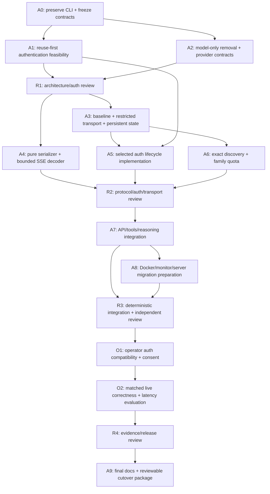

# Direct Antigravity implementation DAG

Status: implementation and local correctness checks complete; release acceptance
remains partial for matched performance, real refresh and wider models (2026-10-20).
The live server and other terminals are out of scope. See the
[plan](direct-antigravity-plan.md) and [research](alternative-direct-provider.md).

## Current evidence

- A0/A1: CLI archive preserved; supported-login reuse investigated, approved
  separate Google sign-in and project resolution completed locally.
- A2–A8: model-only replacement, pinned transport, OAuth, reviewed exact-ID
  discovery, private replay, Docker, helpers and advisory reporting implemented.
- R1/R2: independent architecture, auth, wire and integration reviews completed;
  findings fixed, including the live Claude empty-text replay failure.
- R3: 181 Rust tests, 38 official SDK and 8 Vercel SDK checks, monitor PTY,
  Docker policy, production build and runtime smoke passed. Clippy completed
  with two retained style warnings; no temporary diagnostics remain.
- O1: local consent and discovery passed: 13 reviewed Antigravity IDs and 7
  OpenAI IDs, with sign-in surviving gateway recreation.
- O2: after the replay fix, 15 live checks passed for each Flash High, Opus
  Medium and Sonnet High. Flash Low passed 15 checks earlier in development.
  Argon Medium returned upstream quota errors. Real refresh and authenticated
  CLI/direct matched latency remain unverified; the operator comparison helper
  is ready. No speed ratio is claimed.
- R4/A9: code/evidence reviews and local implementation package are complete;
  performance/lifecycle release gates remain open. See [validation](validation.md).
  The existing local 8091 service, live server and other terminals were untouched.

## Work packages and acceptance

| ID | Dependencies | Deliverable | Completion evidence |
| --- | --- | --- | --- |
| A0 | None | Preserve CLI revision; record accepted scope, source revision/license, public contracts and rollback. | Local branch exists at `4d23e015`; no push. Freeze retained model APIs/IDs, OpenAI isolation, native removal and capability migration. Branch preservation and the compiled contract baseline are complete. |
| A1 | A0 | Establish an operator-approved authentication path. | No documented supported handoff from the old CLI profile was established. The operator approved the reviewed pinned OMP registration and completed a separate sign-in; existing auth volume remains preserved. Local discovery succeeded after the dotted-ID parser fix, with 13 reviewed exact IDs. |
| A2 | A0 | Remove native public routes/types/storage/configuration and define direct model-only contracts around existing provider seam. | Retained APIs still pass; native routes return documented 404; client tools remain inert until handed to the caller. No new provider seam built from scratch. |
| R1 | A1, A2 | Independent architecture/auth design review. | Resolve native dependencies, capability migration, auth method and ownership. If reuse is unavailable, the accepted fresh-login alternative is designed before token lifecycle implementation. |
| A3 | R1 | Reviewed baseline, fixed destinations, central HTTP dispatch gate, persistent account/protocol state and cancellation. | Synthetic tests for origin/redirect/identity refusal, original deadline, restart, concurrent gate closure, queued and background calls. No dispatch after closure except attempts already transmitted. |
| A4 | R1 | Pure native-wire serializer, tool/history conversion, usage mapping and bounded decoder; MIT notice/provenance for incorporated code. | Fixtures for all model families, verbatim legitimate `thought` JSON, signature-only thoughts, grouped tool results, `tool_choice:none` inventory omission, EOF/in-band errors, partial arguments and finish-state validation. No real network. |
| A5 | A1, A3 | Selected reuse interface or independent OAuth lifecycle, state persistence/refresh locks and operator helpers. | Synthetic tests for state/PKCE where supported, callback deadlines, refresh cancellation/rotation, account generations, revocation and project resolution; no secret exposure or implicit enrollment. |
| A6 | A3 | Authenticated exact-ID catalogue, readiness, quotas/cooldowns and advisory release alerts. | Recognized-empty vs malformed roster, disabled/internal/denied IDs, 13 exact variants where present, rejected account stops all further probes, model-family quota isolation, stale data and release failure/changes never auto-update identity. |
| R2 | A4, A5, A6 | Independent protocol, auth and transport review before public wiring. | Compare against pinned OMP source, review known upstream edge cases and Rust bounds. Check all authenticated paths use A3 and account restrictions survive restart without affecting OpenAI. |
| A7 | R2 | Wire direct provider through existing registry/admission/Chat/Responses/items. | All four API modes, complete validated tool handoff, rejection of unexpected calls under `tool_choice:none`, schema buffering, opaque replay scope, cancellation, partial usage and provider outages pass synthetic integration checks. No CLI subprocess/workspace/MCP dependency. |
| A8 | A7 | CLI-free Docker runtime, direct auth/monitor helpers, capability docs and repository migration guidance; live server Compose remains out of scope. | Slim nonroot/read-only image starts without CLI; new state volume isolated; legacy auth preserved; no native scopes/routes; effective status matches admission. Secret-dependent server operations are not executed by Codex. |
| R3 | A7, A8 | Integrated Rust, HTTP/SDK, monitor and Docker acceptance plus independent review. | 181 Rust tests, 38 official SDK and 8 Vercel checks passed; monitor PTY, Docker policy/build/runtime, formatting and independent reviews completed. Two retained Clippy style warnings are documented. |
| O1 | R3 | Operator verifies chosen auth path against the actual account and reviewed endpoint using local Docker. | Approved pinned OMP sign-in, project resolution, 13-ID discovery and restart persistence succeeded locally; no raw state inspected by Codex. |
| O2 | O1 | Matched live correctness and latency comparison with archived CLI and optionally installed OMP. | Partial: post-fix live correctness passed for three selected variants; Flash Low passed earlier and Argon was quota-limited. Matched CLI/direct timing and real refresh remain operator gates. The loopback-only helper records identical request parameters, counts, p50/p95, failures and output hashes without inspecting secret files. |
| R4 | O2 | Independent release/evidence review. | Independent code and correctness evidence reviews passed; no quantified speedup or real-refresh acceptance yet. Keep these release gates open; no automatic fallback or server cutover. |
| A9 | R4 | Reconciled README/capabilities/operations/validation, source attribution and concrete cutover package. | Local documentation/package is prepared and old volume/service/archive retained. Release acceptance remains partial as recorded above. Push and live-server deployment are outside this implementation run. |

## Parallel rounds and review ownership

1. A0, then A1 and A2 in parallel; R1 reviews the result before transport/auth
   implementation. A1 may need an operator result while A2 progresses.
2. A3 and A4 in parallel; after A3, A5 and A6 may proceed independently. R2
   reviews their combined contracts. Keep the dispatch gate owned by A3.
3. A7 owns API integration; A8 follows once configuration is stable. R3 combines
   deterministic checks with an independent code review and fixes.
4. O1/O2 use actual account authorization and matching workloads; R4 reviews
   evidence before A9 prepares the final release package.

Use Luna for bounded source reviews, fixture enumeration and isolated docs or
configuration tasks where suitable. Use a capable implementation/review agent
for OAuth rotation, opaque reasoning replay, SSE terminal states and concurrent
dispatch/latch logic. Each round needs a reviewer other than its implementer.
Coordinate shared edits in `api.rs`, `protocol.rs`, registry and configuration;
agents must not overwrite one another's integration changes.

One topological order is A0, A1, A2, R1, A3, A4, A5, A6, R2, A7, A8, R3, O1,
O2, R4, A9. Offline work can finish before account access is available; live
gates remain incomplete until their evidence exists.
