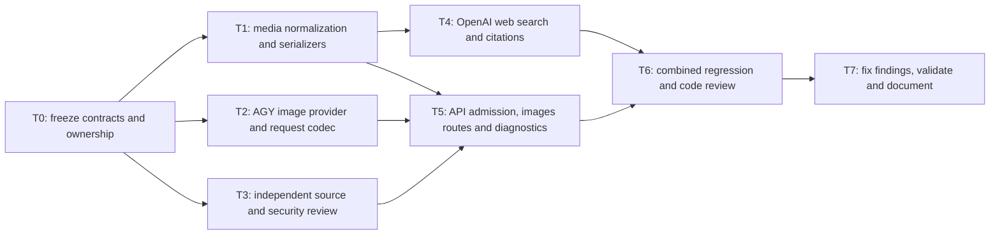

# Multimodal inputs, search and image generation

Approved scope: image understanding on both providers, OpenAI document inputs,
OpenAI hosted web search with citations, and AGY image generation/editing.
Coordinator reviews all worker changes and owns integration and release checks.
Implementation workers use the requested cheaper Codex model, GPT-6 Luna.

## Contract and boundaries

- Keep Chat Completions and Responses compatible with existing text, JSON,
  strict/non-strict tools, forced choices, reasoning replay and streaming errors.
- Canonical message content remains typed JSON. Accept bounded inline images
  (base64 data URLs) and HTTPS image URLs, retaining detail hints where supported.
  No router-side downloading of arbitrary URLs or local file paths. Inline
  images map to AGY `inlineData`; HTTPS URLs may map only to a verified upstream
  URL shape, otherwise return an explicit unsupported error before dispatch.
- OpenAI document input uses inline `file_data` plus filename or HTTPS file_url
  where documented. No uploaded file IDs/Files API, local paths, or AGY native
  PDF claims. Files are OpenAI-only and fail explicitly on AGY, including fallback.
- Keep the existing 1 MiB HTTP/history limit initially; report oversize inputs
  clearly. Media byte/count limits and type checks apply before provider I/O.
- Web search is OpenAI-only, subject to account policy. Preserve hosted search
  output items and URL citations in Responses, Chat and both stream modes.
  Hosted calls are never handed to the client as custom function calls.
- AGY images use only the serving account's advertised image generation IDs,
  with no guessed model, fallback origin or automatic paid generation retries.
  Provide `/v1/images/generations` JSON and `/v1/images/edits` multipart forms
  compatible with standard OpenAI/n8n clients; return bounded base64 images.
- Reuse provider auth, account-generation checks, restrictions, cancellation,
  deadlines, admission, rate limits and metadata-only telemetry. Media contents,
  filenames, URLs, prompts, citations and tool payload values are not persisted.
  Redact inline binary data from memory captures to keep them useful and bounded.
- No saved OAuth inspection, credential imports, environment loading, server
  edits, container restarts or deployment. All `.env*` except exact `.env.example`,
  `*.pem`, `*.key` and content beneath `secrets`/`credentials` are prohibited.
  `.env.example` is text-only and cannot bypass other restrictions or symlinks.
  Recursive content searches must explicitly exclude protected paths.
- Public API capabilities do not imply ChatGPT subscription permission. Keep
  unsupported hosted tools/audio/video/cache-retention features disabled.

## DAG

| Task | Ownership | Observable acceptance |
| --- | --- | --- |
| T0 | Coordinator; this plan | Explicit interfaces, source boundary and worker tasks recorded before edits |
| T1 | Worker; `src/protocol.rs`, `src/media.rs`, `src/openai.rs`, `src/antigravity_wire.rs` | Typed image/file normalization, malformed/oversize tests, real serializer fixtures, text/tool regressions preserved |
| T2 | Worker; new `src/images.rs`, `src/antigravity_images.rs` only | Generation/edit request codecs, exact advertised model selection, bounded complete SSE images, errors/cancellation tests |
| T3 | Review worker; `docs/media-search-review.md` only | Verify OMP/public OpenAI contracts; identify protocol, media logging and client test gaps, no secrets accessed |
| T4 | Worker after T1; `src/protocol.rs`, `src/openai.rs`, plus focused test helpers | Hosted tools/includes parsed separately, safe event decoding, citation bounds, mixed client-tool rounds and failure fixtures |
| T5 | Coordinator integration; `src/api.rs`, `src/config.rs`, `src/lib.rs`, `src/items.rs`, `src/antigravity.rs`, captures | New routes share auth/admission/deadlines/telemetry; real HTTP multipart and streaming/citation contracts; capabilities accurately describe provider limits |
| T6 | Independent reviewer plus coordinator | Inspect complete diff, full isolated Rust/SDK/n8n/Studio tests, monitor/login/policy checks, no regressions or misleading capability claims |
| T7 | Original implementation owner for findings; coordinator for integration/docs | Findings resolved, final tests and clean formatting, completed evidence report with live acceptance stated separately |

Workers share this workspace with exclusive file ownership; T4 waits for T1.
They must not commit, push, modify other repositories, or spawn nested workers.
The coordinator alone stages reviewed work. Runtime orchestration IDs and
completion evidence are recorded below as work progresses.

## Sources

- [OpenAI subscription limitations](https://developers.openai.com/siwc/token-sharing-open-source/preview-limitations)
- [OpenAI images/vision](https://developers.openai.com/api/docs/guides/images-vision)
- [OpenAI file inputs](https://developers.openai.com/api/docs/guides/file-inputs)
- [OpenAI web search](https://developers.openai.com/api/docs/guides/tools-web-search)
- [OMP pinned AGY image implementation](https://github.com/can1357/oh-my-pi/blob/686b5e2fb542848dc3ff1a9e36a42a8fefdd2278/packages/ai/src/images/google-antigravity.ts)
- [OMP pinned shared multimodal conversion](https://github.com/can1357/oh-my-pi/blob/686b5e2fb542848dc3ff1a9e36a42a8fefdd2278/packages/ai/src/providers/google-shared.ts)

## Execution record

- Starting main: `5c7fd4f`; existing baseline: 258 passing Rust tests.
- Orca Run: `run_f8bdece7212c`. T0–T7 complete; integration, review corrections and isolated regression checks passed.
- Live account/provider acceptance is separate from synthetic compatibility.

- T1 initial implementation: task_90d4e52fecd2; T1b document/container fixes:
  task_88a79cce5d77; shared output validator: task_14120ae012ae.
- T2 implementation: task_5b0b6634a75c; review fixes: task_d1ff16feccda.
- T3 contract review: task_0a58a661fef0; cross-reviews task_8fff9eeb1c6a
  and task_a5e8bf014ce9. Review reports are checked into docs for closure.
- T4 hosted search: task_2b3dd52e97df; canonical citations/Chat compatibility
  corrections: task_229d69f19f3b (dispatch ctx_ac51d76a31a8, completed and released).
- SDK tests: task_316cc4081727; pinned SDK harness correction:
  task_e6f2092b12f6 (dispatch ctx_f4ab141880c3, completed and released).
- All workers use confirmed GPT-6 Luna/high; reused workers retain that agent.
- First integrated run: 278 passed, six failed. Real-SDK image generation,
  edit, vision and TCP disconnect cancellation passed. Failures were obsolete
  fixtures/canonical expectations plus the new harness importing httpx instead
  of the pinned SDK's httpx2. These were corrected before final validation.

## Final outcomes

| Task | Outcome and evidence |
| --- | --- |
| T0 | Complete: contract/DAG and exclusive ownership established before implementation. |
| T1 | Complete: typed image/file normalization and provider projections; malformed/count/size/role fixtures pass. |
| T2 | Complete: exact advertised-model generation/edit codec; bounded native SSE completion and non-retryable validation failures pass. |
| T3 | Complete: source/security review documented in [contract review](media-search-review.md). |
| T4 | Complete: hosted tools, sources, history and citations; Chat include and tool-choice fixtures pass. |
| T5 | Complete: protected routes, provider admission, generation guards, telemetry, capabilities and real multipart/TCP integration pass. |
| T6 | Complete: independent [media/API](media-api-review.md) and [image](agy-images-review.md) reviews; 286 Rust tests including existing SDK regressions and 25 new SDK calls pass. |
| T7 | Complete: review findings resolved or explicitly narrowed in the public contract; final binary, monitor PTY, formatting, policy and source-provenance checks pass. |

The five login-helper tests and Docker protected-context policy checks passed.
All 68 source-hash pairs match. Runtime workers have settled and their final
resources have been released. Publication is handled by the coordinator after
explicit user authorization; no server deployment was performed. Live account
acceptance remains an operator check,
not a blocker to this synthetic implementation/review task. Detailed evidence
and acceptance limits are in [validation](validation.md).
