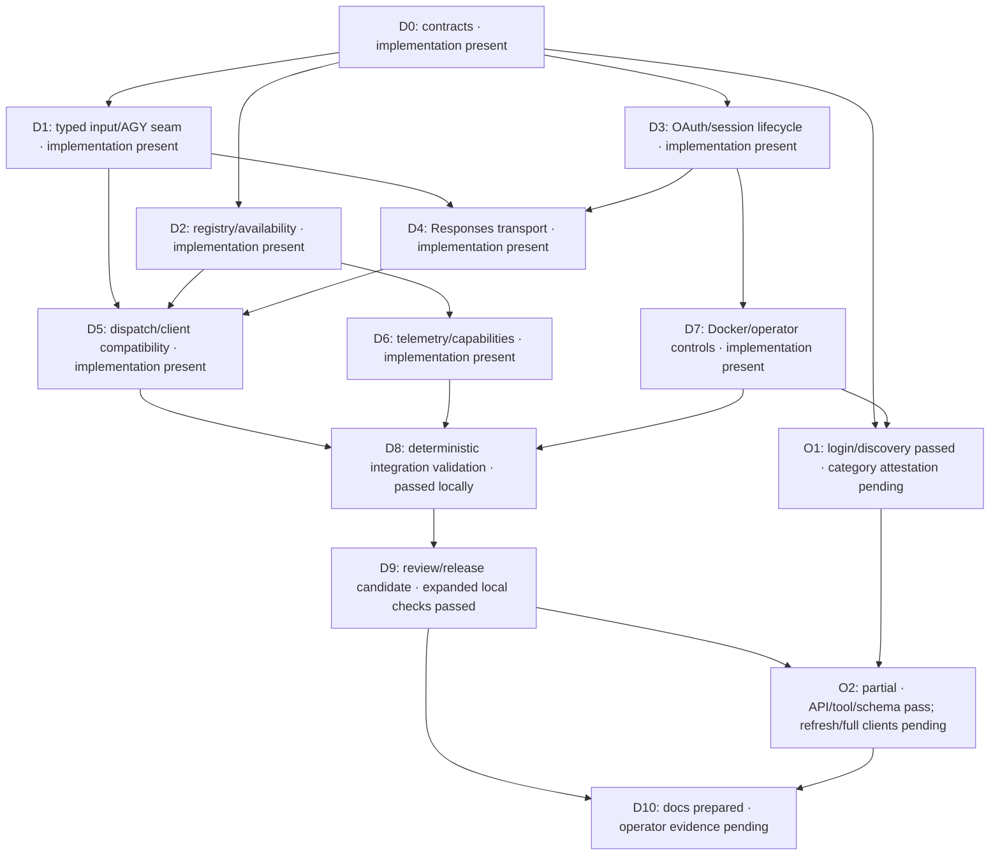

# AGY and ChatGPT subscription routing task DAG

Status: D0-D8 deterministic implementation and acceptance passed locally; see
[validation](validation.md). All 167 Rust tests passed (127 library, 25 HTTP,
15 runner); formatting passed and Clippy passed with the same three existing
warnings. The final production image was rebuilt and started locally with OpenAI
enabled on port 8091. OAuth/discovery found 7 OpenAI and 13 AGY model IDs (20
total), and selected state persisted across container recreations. The strict
SSE decoder handles observed events without a Content-Type header; bounded item
reconstruction fixed empty final tool output. All four live `gpt-6-luna`
Chat/Responses streaming modes, Chat and Responses tool continuations, and
validated JSON schema passed. O2 remains partial: real rotating refresh and full
installed-client checks have not been performed. O1 login/discovery passed, but
integration-category review is not independently attested. D9 release readiness
and final D10 evidence remain open. Do not treat this DAG as full live
subscription acceptance. Design semantics live in
[the implementation plan](openai-subscription-plan.md).

## Dependency graph

OAuth unit tests and transport development use synthetic services. O1/O2 are
operator-authorization gates distinct from deterministic implementation. The
current local Docker runtime test was explicitly authorized; any use of signed-in
runtime state stays within the normal gateway/helper flow and never exposes raw
token files. Dependency branches may be scheduled independently after their
contracts are fixed; this document does not require spawning agents. A single
implementer can follow the same topological order. Review fixes stay within their
node; a new scope discovered during review gets a new forward dependency, never
a cycle.

## Work packages

| ID | Depends on | Deliverable and principal files | Completion evidence |
| --- | --- | --- | --- |
| D0 | None | Recheck official OAuth/preview schemas; document provider, typed-message, event/terminal-state, registry, status and capability contracts in `docs/interfaces.md`. Freeze provider defaults and telemetry migration. | Contracts cover account generations, collision policy, quota recovery, reasoning-state replay, native separation and no automatic generation retries. Record unresolved upstream capabilities as disabled. |
| D1 | D0 | Refactor `src/protocol.rs`, `src/runner.rs`, `src/api.rs`, `src/native.rs`, `src/lib.rs`; introduce shared provider types and AGY adapter. Move transcript rendering into AGY. | Existing fake-AGY/HTTP/SDK/tool/native-gate tests pass with equivalent AGY prompts, call IDs, isolation, usage and cancellation. OpenAI execution needs no workspace. |
| D2 | D0 | Add model registry and independent probe/state manager; extend `src/config.rs` and bootstrap in `src/main.rs`. Use stub providers against the D0 interface. | Atomic union, exact-ID ownership, conflicts, stale snapshots, quota latch/resume, account-generation invalidation, bounded last-known IDs, and independent refreshes tested with controlled time. |
| D3 | D0 | Add OpenAI OAuth/session modules and operator command handlers. Implement registration, token verification, state storage, serialized rotating refresh, selected registration, logout/revocation and resume. | Local mock issuer/JWKS tests prove state/nonce/PKCE/scope/identity checks, locked refresh, atomic writes, path protections, terminal vs transient failures and no token leakage. |
| D4 | D1, D3 | Add OpenAI HTTP discovery, typed Responses serializer, bounded SSE decoder and cancellation. Add reviewed HTTP/OAuth dependencies in `Cargo.toml`/`Cargo.lock`. | Mock requests prove account-model response parsing, fixed destinations, `store:false`/`stream:true`, correct history/tools, all terminal states, usage, quotas and no unsafe retries or redirects. |
| D5 | D1, D2, D4 | Wire provider/model dispatch into `src/api.rs`, provider-fair admission, `/ready`, model listing, both output renderers and `src/items.rs` provenance. Keep native explicitly AGY. | Both providers are addressable with unchanged client setup; provider-only outages and stalls are isolated; Chat-to-Responses tools and history work; schema/incomplete/error/storage semantics are accurate. |
| D6 | D2 | Update `src/monitor/mod.rs`, `src/monitor/ui.rs`, `src/monitor/payload.rs`, capability serialization and status command formatting. Reconcile API wiring with D5 before D8. | Multiple statuses, provider-tagged usage/errors, usage link, legacy telemetry defaults, capability schema migration and synthetic credential/opaque-state redaction pass. |
| D7 | D3 | Add operator helpers, dedicated OpenAI named volume, callback helper and configuration to `Dockerfile`, `compose.yaml`, scripts and `docs/operations.md`. | Synthetic container acceptance proves persistence, nonroot/loopback constraints, helper/server refresh exclusivity, protected state and AGY denial. Existing AGY-only startup works without OpenAI state. |
| D8 | D5, D6, D7 | Extend deterministic Rust, HTTP, OpenAI SDK, n8n/Hermes-shaped and monitor contracts. Extend Docker-only test scripts with mock services and synthetic volumes. | Passed locally: 167 Rust tests (127 library, 25 HTTP, 15 runner); 235 OpenAI 3.24.0 TCP/SDK/policy checks; 122 n8n Vercel AI 7.0.66/OpenAI 4.0.20 checks; 109 pinned AGY 1.4.3/gateway/MCP loopback checks; monitor PTY and Docker policy. These deterministic tests use synthetic state and do not establish subscription access. |
| D9 | D8 | Review security, routing, lifecycle, protocol and migration boundaries; fix findings and rerun affected checks. Prepare an opt-in release candidate. | Cross-review fixes include refresh cancellation/generation handling, account-scoped opaque state, explicit deadlines, upstream request-ID telemetry/error mapping, generic `ai_router_usage_partial` preserving the legacy AGY field, and bounded item reconstruction for completed tool output. Formatting passed; Clippy passed with three existing warnings. Final production image rebuilt and started with OpenAI enabled. Expanded local API/tool/schema checks passed; full installed clients and real rotating refresh remain open. |
| O1 | D0, D7 | Operator confirms integration category and actual account eligibility, completes OAuth, and selects a registration. | OAuth login/discovery found 7 OpenAI and 13 AGY model IDs; state persisted across container recreations. Independent integration-category attestation remains pending, so O1 is partial. Only sanitized outcomes are recorded; no raw token files are inspected. |
| O2 | D9, O1 | Operator exercises actual AGY + OpenAI, refresh/restart persistence, both client APIs, tools and intended installed clients. | Partial: AGY Chat/Responses streaming and client-tool round trips passed. All four live `gpt-6-luna` Chat/Responses streaming modes, Chat and Responses tool continuations, and validated JSON schema passed. Real rotating refresh and full installed-client checks have not been performed. |
| D10 | D9, O2 | Update README, `docs/capabilities.md`, `docs/validation.md`, interfaces and operations with shipped behavior, enable/disable procedure and rollback. | Documentation reflects deterministic and expanded local evidence and partial O1/O2 results. Independent category attestation and the remaining O2 checks are pending; rollback disables OpenAI without affecting AGY. |

## Integration boundaries

Shared files need coordinated edits even when dependency branches are independent:

- D0 owns interface decisions; D1 introduces their Rust representation. D2 and
  D3 can initially target those contracts with local stubs.
- D5 owns final `src/api.rs` routing/admission integration. D6 supplies capability
  and monitoring structures; avoid separate competing rewrites of handlers.
- D3 owns session locking and persistence. D7 calls those handlers rather than
  implementing a second refresh/login mechanism in shell.
- D4 owns HTTP/SSE transport. D5 owns client API rendering and local item storage;
  retain required provider state across their boundary without logging it.
- D8 integrates fixture/script changes against the existing working tree. Do not
  replace unrelated in-progress AGY version or containment changes.

One valid order is D0, D1, D2, D3, D4, D5, D6, D7, D8, D9, O1, O2, D10.
O1 can move earlier after D7. The main transport dependency chain is
D0 → D1/D3 → D4 → D5 → D8 → D9 → O2 → D10; D6/D7 also gate D8.

## Deterministic acceptance matrix for D8

| Area | Required scenarios |
| --- | --- |
| Catalogue/routing | AGY only, OpenAI only, both, neither, provider disabled, duplicate ID, unknown ID, removed model, stale probe, atomic concurrent refresh, caller uses cached hidden ID |
| Availability | Invalid/missing scope, expired token, transient refresh/discovery outage, terminal revocation, ineligible account, usage limit before and after stream start, explicit resume, recovery without touching the other provider |
| Concurrency | Concurrent rotating refresh across processes, account change while queued, logout during execution, probe timeout, queue saturation, provider stall in each direction, bounded disconnect/shutdown cleanup |
| API output | Chat/Responses × stream/nonstream; stable IDs, full history/instructions, single/multiple tool calls, tool-result continuation, malformed arguments, validated JSON, incomplete/error terminal mapping, missing/partial usage |
| API input | Unsupported parameters/tool types, ignored cache hints, disclosed budget guidance, unsupported reasoning controls, denied hosted tools/modalities, upstream array input and field filtering |
| Storage | `store` default/false, client ownership, TTL/eviction/restart, local item expansion limits, opaque provider-state replay, cross-provider replay rejection, legacy telemetry loading |
| Security | Synthetic PKCE/state/nonce/issuer/audience/signature/scope failures, callback binding, symlink/hardlink protections, refresh lock/atomic replacement, redirect refusal, no auth/opaque-state payload leakage |
| Existing behavior | AGY fake-runner and CLI contract suites, inert tool correction, native gate/artifacts, OpenAI models rejected on AGY native routes, unchanged public client keys/base URL, loopback Docker and context-policy checks |

Run checks appropriate to the implementation in the established Docker workflow:
format/lint/compile checks, Rust tests, HTTP/SDK/client contracts, monitor tests,
and container/policy checks. Synthetic OpenAI services must be explicitly wired
and cannot fall back to official endpoints. Tests must explicitly exclude all
forbidden file patterns and use disposable synthetic auth volumes.

## Release gates

- D1 checkpoint: AGY-only behavior survives the provider refactor.
- D8 checkpoint: deterministic dual-provider implementation works without login.
- D9 checkpoint: complete remaining refresh and full-client checks before declaring the reviewed opt-in candidate ready.
- O1/O2 checkpoint: actual subscription eligibility and client behavior verified.
- D10 checkpoint: documentation and evidence match the shipped implementation.

Do not mark O1/O2 complete based on fixtures, model listing alone, or an agent
reading raw signed-in credential files. If upstream preview behavior differs,
update the plan, affected contracts and acceptance criteria before expanding
advertised support.
